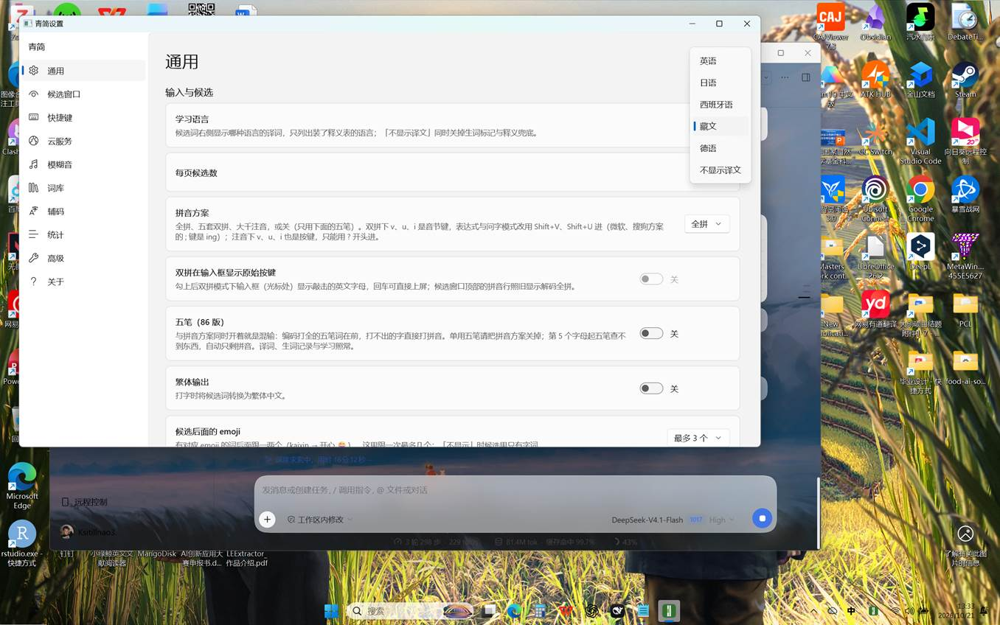

# 青简藏文输入适配（Tibetan add-on）

在青简输入法上打中文拼音，**候选保持中文**，高亮候选下方显示对应的**藏文 + 威利转写（Wylie）**；
「设置 → 通用 → 学习语言」下拉里增加一项 **藏文**（替换“越南语”，日语保留）。

```text
zangwen  →  1 藏文      （下方）བོད་ཡིག  bod yig
xiexie   →  1 谢谢      （下方）ཐུགས་རྗེ་ཆེ  thugs rje che
```




> 另有「藏文优先」模式：候选本身就是藏文、下方显示威利，见 `--mode candidate`。

## 这个目录是什么

青简的语言枚举写死在 Rust 程序里，没有插件机制新增语言。本目录是一套**不改青简源码**的适配包，
全部走青简自带的扩展点，适合直接装在本机使用，也方便以后把数据并进真正的源码分支：

| 需求 | 扩展点 | 落点 |
| --- | --- | --- |
| 中文候选下方显示“藏文 + 威利” | 个人释义表（`词<TAB>释义`，覆盖随包译词） | `%APPDATA%\Qingjian\user-glossary-vi.tsv` |
| 候选窗能显示藏文 | 候选窗字体（系统 Segoe UI 没有藏文字形，会显示方块） | `config.toml` → `font = "Microsoft Himalaya"` |
| 设置下拉出现“藏文” | 设置程序等长字节替换（“越南语” 9 字节 → “藏文”+3 空格 9 字节） | `C:\Program Files\Qingjian\qingjian-settings.exe` |

底层语言仍然记为 `vi`：选中“藏文”后青简读随包 `glossary-vi.qj` + 我们的 `user-glossary-vi.tsv`，
其中 26,876 条中文词被写成“藏文 + 威利”。日语选项完全不受影响。

> 设置程序补丁是可选的“显示名”补丁，不改输入逻辑；青简升级/重装会覆盖它，需要重打。
> 原版备份和还原脚本都在 `tools/` 下。

## 数据

- **《藏汉词典》**（25,241 条，UTF-16）反查出 **2.6 万条中文 → 藏文**，
  再加 **223 条人工常用词**、短语层，最终 **26,876 条中文注释**。
- **威利转写**：`data/syllables.tsv`（18,774 个音节）+ `data/wylie-chars.tsv`（构件表），
  由 [bmwj/Tibetan_information_processing](https://github.com/bmwj/Tibetan_information_processing)（MIT）的
  音节分解表生成；不在表里的梵文/罕见连写走逐字回退。

`pack/` 里是生成好的结果，直接用即可；想重跑生成脚本，按 `sources/README.md` 把源数据放好。

## 目录

```text
data/curated.tsv             人工常用词（中文<TAB>藏文）
data/phrases.tsv             常用短语
data/extra.tsv               你自己的词（可选，格式同 curated.tsv）
data/syllables.tsv           音节 → 威利
data/wylie-chars.tsv         构件 → 威利
pack/annotations-tibetan.tsv 中文 → 藏文+威利（注释模式，默认）
pack/annotations-combined.tsv 中文 → 藏文+威利｜原译词（可选）
pack/tibetan.tsv             青简词库（藏文优先模式）
pack/glossary.tsv            藏文 → 威利（藏文优先模式）
pack/choices.tsv             预置选择（藏文优先模式）
pack/wylie-reference.tsv     中文/拼音/藏文/威利 对照表
tools/wylie.py               藏文 → 威利
tools/build_pack.py          生成 pack/（需要 pypinyin）
tools/gen_wylie_table.py     从源数据生成威利表（需要 xlrd）
tools/install_pack.py        安装到青简
tools/uninstall_pack.py      卸载并还原配置
tools/convert_text.py        独立转换器（中文 → 藏文 + 威利）
tools/selfcheck.py           安装前数据自检
tools/patch_settings_label.py 生成“藏文”显示名补丁
tools/apply_label_admin.ps1   管理员运行：安装显示名补丁
tools/restore_label_admin.ps1 管理员运行：还原设置程序
sources/README.md            重跑数据生成时需要放的源数据说明
```

## 安装

在本目录下：

```powershell
# 1. 自检（可选：数据改过就先跑 python tools/build_pack.py）
python tools/selfcheck.py

# 2. 安装注释，并把学习语言选中“藏文”对应的 vi
python tools/install_pack.py --mode annotation --annotations tibetan --lang vi --set-language

# 3. 生成设置程序补丁，然后右键“以管理员身份运行” tools\apply_label_admin.ps1
python tools/patch_settings_label.py
```

安装做了什么（默认注释模式）：

1. 删除 `%APPDATA%\Qingjian\dicts\tibetan.tsv`（让候选保持中文），清掉藏文预置选择。
2. 把 `pack/annotations-tibetan.tsv` 合并进 `user-glossary-vi.tsv`，并清掉其它语言的同批注释。
3. `config.toml`：`learning_language = "vi"`、`font = "Microsoft Himalaya"`、`[predict] enabled = false`
   （关云兜底，否则上屏后释义兜底会把词翻成越南语写回个人表，冲掉藏文注释）。
4. 杀掉 `qingjian-server.exe`，下次按键自动重启加载。

`apply_label_admin.ps1` 会备份原设置程序到 `backup/`，然后把补丁版覆盖到
`C:\Program Files\Qingjian\qingjian-settings.exe`；还原用 `restore_label_admin.ps1`。

卸载：

```powershell
python tools/uninstall_pack.py
# 如需还原设置程序：右键管理员运行 tools\restore_label_admin.ps1
```

## 使用

1. `Win+Space` 切到「青简」。
2. 正常打拼音，候选 1 是中文；高亮候选下方橙色小字就是「藏文 + 威利」。
3. 空格/数字键上屏的是中文。要打藏文时用 `tools/convert_text.py`，或切到 `--mode candidate`。

命令行转换：

```powershell
python tools/convert_text.py "中国 西藏 拉萨"
python tools/convert_text.py --format wylie "谢谢朋友"
```

输出：

```text
རྒྱ་ནག བོད ལྷ་ས
rgya nag bod lha sa
```

## 已知取舍

- 只有**高亮候选**显示注释（青简横排设计），移动高亮即可看其它词。
- 没进词表的中文词会显示随包**越南语**译词（底层 vi 表）；加进 `data/extra.tsv` 再重跑即可。
- 《藏汉词典》偏书面/百科，日常口语覆盖有限；自己的课本词加 `data/extra.tsv` 最有效。
- 青简升级/重装会覆盖设置程序补丁与 `user-glossary-vi.tsv`，需要重跑安装。
- 设置程序补丁是本地显示名替换，不是上游语言枚举的新增；要真正合并进青简，需要在
  `crates/qingjian-core/src/candidate/language.rs` 增加 `Language::Tibetan` 并重编译。

## 数据来源与许可

- 青简输入法：GPL-3.0-or-later，[qingjian-team/qingjian](https://github.com/qingjian-team/qingjian)。
- 《藏汉词典》与藏文转拉丁数据：[bmwj/Tibetan_information_processing](https://github.com/bmwj/Tibetan_information_processing)，MIT；
  词典正文著作权归原编者/出版方，本目录只分发整理后的词对与转写表。
- 威利转写采用标准 Wylie；`འ` 写作 `'`，`ཱ` 写作 `A`，`ཱུ` 写作 `U`。
